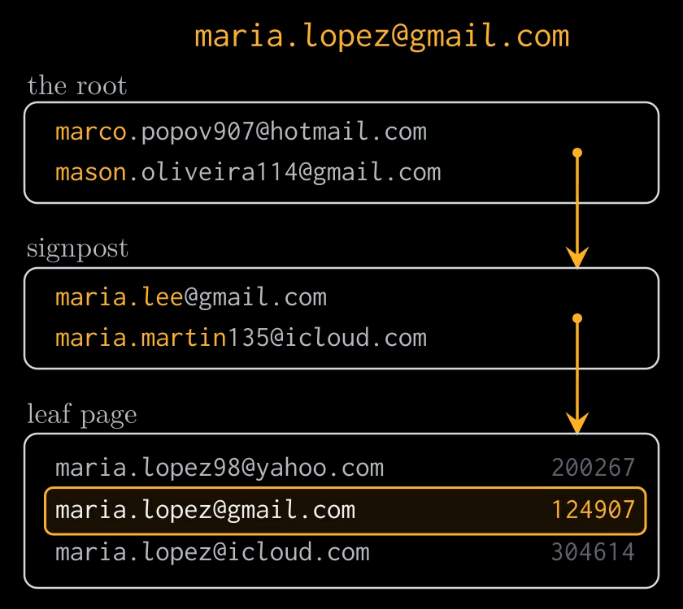

# How a database index finds a row: inside SQLite's B-tree pages

What does SQLite actually read for `SELECT * FROM users WHERE email = ?`? These materials open the database
file and read its pages: the table's B-tree in id order, the scan that reads all 10,035 of its pages,
the index as a second B-tree of sorted `(email, id)` pairs, and the real path of one lookup:
6 pages, root to leaf in the index, then down the table's own tree to the row.

```text
index idx_users_email   page 10,037 (root) → page 14,971 (signpost) → page 15,020 (leaf): maria.lopez@gmail.com, id 124,907
table users             page 2 (root)      → page 1,386 (signpost)  → page 1,219 (leaf):  the row, Lima, 36
```

From there the usual rules stop being rules of thumb and become things you can see in the pages: why
`LIKE '%@yahoo.com'` scans (120,579 matches spread over all 7,967 leaf pages of
the index), why `LIKE 'maria.lo%'` doesn't (35 matches on one leaf page) and why it
needs a column that ignores case, why an index on `(city, age)` can't answer `WHERE age = ?`, and why one
`INSERT` changed pages in every tree.



## What's inside

| | |
|---|---|
| [`notes.pdf`](notes.pdf) | The handout: the file of pages, the scan, what `CREATE INDEX` builds, the walk through both trees, the leading wildcard, prefixes and `COLLATE NOCASE`, two-column indexes, what one write changes, limits, common mistakes, exercises with answers |
| [`notebook.ipynb`](notebook.ipynb) | Build the table and read its pages yourself, with a page reader you can read in one sitting; `FULL = True` for the notes' table |
| [`code/pages.py`](code/pages.py) | The page size in the file header, the table's B-tree, its root's signposts, the first leaf down to the bytes of one row |
| [`code/scan.py`](code/scan.py) | `SCAN users`: walks the leaves in id order and shows where the row is and why reading doesn't stop there |
| [`code/index_pages.py`](code/index_pages.py) | What `CREATE INDEX` built: both trees side by side, the index's first leaf, one entry byte by byte |
| [`code/walk.py`](code/walk.py) | The lookup page by page: index root → signpost → leaf → the table's root → signpost → leaf |
| [`code/sort_order.py`](code/sort_order.py) | Plans and leaf pages for a leading wildcard, a prefix, `LIKE` with and without `COLLATE NOCASE`, a function on the column, a two-column index |
| [`code/writes.py`](code/writes.py) | One `INSERT` with zero, one and two indexes: every changed page, its tree, its cells and free bytes before → after |
| [`code/usersdb.py`](code/usersdb.py) | The table (same seed and generator as the notes) and the page reader the scripts share; also builds a `users.db` to keep |
| [`figures/`](figures) | The pictures in the notes, stills from the video lessons |

## Run it

Python 3.9 or newer, standard library only. Every script builds its own database in a temporary folder.

```bash
python3 code/walk.py --quick                         # 100,000 rows: about a second
python3 code/walk.py                                 # the notes' 1,000,000-row table: about five seconds, 74 MB, temporary
python3 code/walk.py --email daniel.kim@outlook.com  # nobody has it: the leaf proves it isn't there
python3 code/walk.py --email Maria.Lopez@Gmail.com   # the same three pages: the column ignores case

python3 code/usersdb.py users.db --indexes           # keep a database to explore, then:
sqlite3 users.db "SELECT name, pagetype, count(*) FROM dbstat GROUP BY 1, 2"
sqlite3 users.db "EXPLAIN QUERY PLAN SELECT * FROM users WHERE email = 'maria.lopez@gmail.com'"
```

## How the numbers were made

Nothing in the lesson is timed: it counts pages, bytes and rows, read from the file. A table of 1,000,000
made-up users (seed 2026) is built in SQLite 3.45.3 through Python's `sqlite3` module. The emails look real: common first and last names from many countries, paired at
random, at the big mail providers, so no row is a real person's data. Page counts and tree shapes come from
SQLite's `dbstat` table and, independently, from decoding the file page by page per the
[file format spec](https://www.sqlite.org/fileformat2.html); plans from `EXPLAIN QUERY PLAN`; what a write
changes from comparing the whole file before and after. With the same SQLite version the scripts print the same
page numbers as the notes, to the page.

Found a mistake, or a page number you can't reproduce? Open an issue with the output of `python3 code/walk.py`
and your SQLite version.

## About

Part of a series of short programming lessons that show what happens under the hood: a video, these notes, a
notebook and the code that reads every number from a real run.

Made by Bakytzhan Kurmanbek.

More lessons: [bkurmanbek on GitHub](https://github.com/bkurmanbek).

Ideas for a lesson, a collaboration or a project? bakytzhan.kurmanbek@nu.edu.kz
