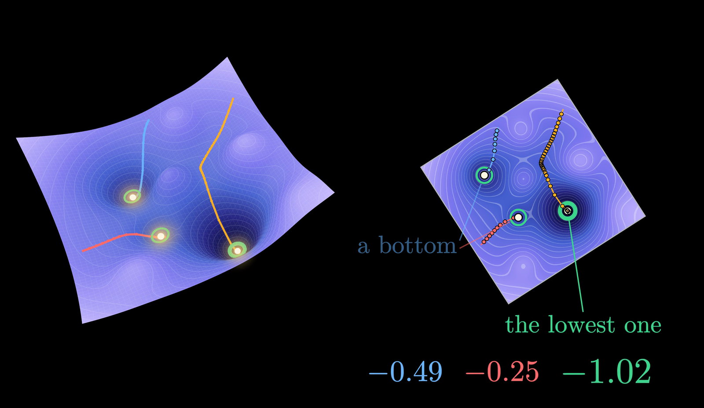

# How does a computer find the lowest point of a landscape it can't see?

Gradient descent from scratch: feel the slope, step against it, repeat. These materials go with the video lesson.
They start from a one-knob valley you can walk by hand, then cover the gradient on a two-knob landscape, the step size
and the exact number that decides it, a computer fitting a line to apartment rents on its own, and the family of walks
that train real models (stochastic, mini-batch, momentum, Adam), each taken apart on the same line. The code makes
every number: the walks run for real in plain Python, and the answers they are checked against come from exact
fractions. Nothing is timed.

```text
one knob, eta = 1/4               6 → 4 → 3 → 2.5 → 2.25             each step halves the distance to the bottom
step sizes 1/20, 1/4, 3/4         57, 9, 9 steps to within 0.01      distance × (1 − 2η) per step
step sizes 1 and 11/10            never: bounces forever, flies off
two knobs, eta = 0.5              36 steps to the deep valley (-1.024); 12 to a shallow one (-0.489), 19 to a small dip (-0.248)
the landscape's step limit        2 / 2.850 = 0.7017; at eta = 1 it never settles
a line through 12 apartments      typical miss 603.8 → 132.9 euros in 40 steps, 0.46 from least squares
the same line, usual knobs        a valley 97,590× more curved one way: 738,888 steps
one apartment per step            never settles at eta = 0.08: hovers 121.71 euros from the best line
four per step                     hovers 30.75; with a shrinking eta, within half a euro for good from step 10,388
a heavy ball (beta 0.9)           past the dip by step 11, settles in the deep valley; usual knobs: 73,827 steps
Adam, eta = 1                     usual knobs: 3,117 steps, then thrown out 24 times in 20,000
```



## What's inside

| | |
|---|---|
| [`notes.pdf`](notes.pdf) | The handout: the slope and how it is felt, the rule by hand, the gradient and why it points uphill, two valleys and a dip, the step size and its limit 2/curvature, a line fitted to 12 apartments and why it tilts before it slides, the long thin valley of the usual knobs, the family (batch, stochastic, mini-batch, momentum, Adam) with their update rules and what each one does inside, Cauchy's note of 1847, where it stops working, common mistakes, exercises with answers, sources |
| [`notebook.ipynb`](notebook.ipynb) | Run it yourself: slopes from two heights, the walk in exact fractions, five step sizes plotted, the landscape with its three walks and the bouncing one, a scan of step sizes across the limit, the line and its error bowl, the long thin valley, then the family: one and four apartments per step, a shrinking step, the heavy ball, Adam's per-knob steps; two "your turn" experiments |
| [`code/descent.py`](code/descent.py) | The video's four-line loop, exactly: prints 4.0, 3.0, 2.5, 2.25 |
| [`code/one_knob.py`](code/one_knob.py) | The slope felt from two heights, and the walk in exact fractions; `--eta`, `--start`, `--steps` |
| [`code/step_size.py`](code/step_size.py) | The five step sizes side by side and each walk drawn on a number line, step by step; `--eta` for your own |
| [`code/landscape.py`](code/landscape.py) | The two-knob landscape: the gradient, the three walks, the bottoms with their curvatures and step limits, the heavy ball that rolls through the dip, the bouncing walk, and text maps; `--eta`, `--start`, `--beta`, `--plot` |
| [`code/rent_line.py`](code/rent_line.py) | The line through 12 apartments: the walk, the exact least-squares answer in fractions, why each knob moves as it does, and the same fit with the usual knobs (738,888 steps); `--plot` |
| [`code/family.py`](code/family.py) | The family on the same line: each apartment's own slope, one and four apartments per step (how far each hovers, and why four is about four times calmer), a shrinking step, momentum on both sets of knobs, and Adam's per-knob step sizes and bursts; `--plot` |
| [`figures/`](figures) | The pictures in the notes: stills from the video lesson, and eight charts drawn from the runs |

## Run it

Python 3.9 or newer, standard library only (matplotlib optional, for `--plot` and the notebook's pictures). Every
script runs from the folder root or from `code/`, in well under a second unless noted.

```bash
python3 code/descent.py               # 1 4.0 / 2 3.0 / 3 2.5 / 4 2.25
python3 code/one_knob.py --eta 3/4    # the walk that overshoots and bounces in, in exact fractions
python3 code/step_size.py             # five step sizes, each walk drawn on a number line
python3 code/landscape.py             # the gradient, the three walks, the heavy ball, the step limit, text maps
python3 code/landscape.py --eta 0.71  # just past the limit: watch it keep bouncing
python3 code/landscape.py --start 0.6 -2.6 --eta 0.15 --beta 0.5   # a heavy ball with less memory
python3 code/rent_line.py             # the line, and the usual knobs' 738,888-step walk: about 2 s
python3 code/rent_line.py --quick     # the same without the long walk, instantly
python3 code/family.py                # stochastic, mini-batch, momentum, Adam on the same line: under a second
```

## How the numbers were made

Nothing is timed. Every position, slope, height and step count comes from running the walks, with the same starts,
step sizes and stopping rules as the video. The one-knob walks use exact fractions; the landscape and the line use
ordinary floating point, and their best answers are checked against algebra: the landscape's bottoms are polished with
Newton's method and checked (slope zero, curving up both ways), and the line's best fit is computed in exact fractions
by least squares. The landscape is a made-up formula, written out in `code/landscape.py`. The 12 apartments
are made up too: generated from a fixed seed (1847) around a believable Lisbon price per square metre, not
real listings. The stochastic walks shuffle the apartments once per epoch from another fixed seed
(7), the same shuffles in every run. Where Adam's bursts fall depends on rounding in the
last digit, so on another machine or with the update written differently they can move; that they keep coming
doesn't.

The history is cited, not computed: Augustin-Louis Cauchy's note in the Comptes rendus of 1847,
Claude Lemaréchal's account of it (2012), Robbins and Monro (1951) for the shrinking step, Polyak (1964) for the heavy
ball, Kingma and Ba (2014) for Adam, and the GPT-3 paper (2020) for "billions of knobs", each linked in the notes.

Found a mistake, or a number you can't reproduce? Open an issue with the script's output and your Python version.

## About

Part of a series of short lessons that show what happens under the hood: a video, these notes, a notebook and the
code that makes every number from a real run.

Made by Bakytzhan Kurmanbek.

More lessons: [bkurmanbek on GitHub](https://github.com/bkurmanbek).

Ideas for a lesson, a collaboration or a project? bakytzhan.kurmanbek@nu.edu.kz
