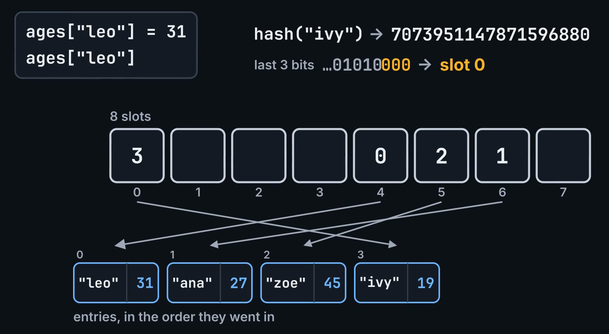

# How a Python dictionary finds a key

You write `ages["leo"]` every day. Python doesn't look through the keys to answer it: it hashes `"leo"`, takes
the last bits of that number as a slot, follows the slot to one entry and compares one key. This folder shows
each of those steps on a real dictionary, read straight out of CPython's memory, and lets you read your own.



What we read from a real `ages` dictionary on CPython 3.12.7 (arm64, `PYTHONHASHSEED=0`):

| Step | What happens inside | Read from the real table |
|---|---|---|
| hash | `hash("leo")` turns the key into one 64-bit integer (salted per process for `str`) | 6416341914839982780 |
| slot | its last three bits pick one of 8 slots: `hash & 7` | `…10111100` → slot 4 |
| entry | the slot holds an entry number; the entries keep insertion order | slot 4 → entry 0: `"leo"`, 31 |
| lookup | hash again, same slot, compare one key; an empty slot means the key isn't there | 1 key compared in a dict of 1,000,000; `"ron"` → empty slot 3 → `KeyError: 'ron'` |
| collision | `"kai"` also lands on slot 4: next slot `(5 * 4 + 1 + (hash >> 5)) & 7` | slot 1 |
| resize | at two-thirds full the table is rebuilt and every key placed again | 8 → 16 slots, 184 → 272 bytes |
| keys | a key's hash must never change, so a list can't be a key | `TypeError: unhashable type: 'list'` |

## What's inside

| | |
|---|---|
| [`notes.pdf`](notes.pdf) | The handout: the wrong mental model, then one section per step (hash, slot, entries, lookup, collision, resize, the key rule), what it explains (insertion order, set order, `1 == True` as one key, NaN), the limits, common mistakes, five exercises with answers, references into the CPython source |
| [`notebook.ipynb`](notebook.ipynb) | Look inside on your own machine: hash values and the salt, `hash & mask`, the real index and entries of a dict, a set's iteration order as its slot order, `getsizeof` across a resize, the unhashable list and a key whose hash changes. Runs in seconds |
| [`code/hash_slot.py`](code/hash_slot.py) | Steps 1–2: hashes, their last bits and slots; the salt across fresh processes; how ints hash |
| [`code/peek_dict.py`](code/peek_dict.py) | Steps 3–6: builds the lesson's dict key by key and prints its real index and entries after every insert, the collision arithmetic and the resize, checked against a replay of CPython's placement code |
| [`code/count_compares.py`](code/count_compares.py) | Step 4: counts `__eq__` calls: one per hit in a dict of a million keys, none for a miss, and what a constant hash does |
| [`code/growth.py`](code/growth.py) | Step 6: `sys.getsizeof` and the real slot count at every resize, for a dict and a set, checked against both growth rules |
| [`code/key_rules.py`](code/key_rules.py) | Step 7: the unhashable list, a key whose hash changes and gets lost (its entry still stores the old hash), `1`/`1.0`/`True`, NaN |
| [`code/set_order.py`](code/set_order.py) | Why a set's order is its slot order and changes between runs, while a dict keeps insertion order |
| [`code/probe_lengths.py`](code/probe_lengths.py) | The limit of "one slot": how many slots lookups really visit in a real set of ten million names |
| [`code/cpython_tables.py`](code/cpython_tables.py) | The shared reader: a dict's and a set's table out of memory with `ctypes`, plus CPython's probe and growth rules in Python |
| [`figures/`](figures) | Stills from the video lesson used in the notes |

## Run it

Python 3.11 or newer for the scripts that read memory (64-bit CPython, the regular build; anything else gets a
clear message instead of a wrong answer). Standard library only. Run from this folder or from `code/`:

```bash
python3 code/peek_dict.py              # the table the video draws, insert by insert
python3 code/peek_dict.py --salted     # the same keys with your process's own salt
python3 code/hash_slot.py
python3 code/count_compares.py         # 1,000,000 keys: a few seconds, ~300 MB (--quick: 100,000)
python3 code/growth.py
python3 code/key_rules.py
python3 code/set_order.py
python3 code/probe_lengths.py --quick  # the full 10,000,000-name run: about 25 s, 1.3 GB
```

## How the numbers were read

Nothing here is timed. The tables are read from the dictionary itself with `ctypes` (the `PyDictObject` and
`PyDictKeysObject` layouts of CPython 3.11+), and every read is checked twice: the bytes must agree with `len()`
and with the keys the dictionary really holds, and the index must equal a replay of CPython's own placement code
(`Objects/dictobject.c`). String hashes are salted per process, so the scripts re-run themselves with
`PYTHONHASHSEED=0` unless you pass `--salted`: that is how your output matches the video's slots exactly. On
another seed the slots differ and the rules don't.

Found a mistake, or output that doesn't match? Open an issue with your Python version and the script's output.

## About

Part of a series of short programming lessons that open up one everyday line of code: a video, these notes, a
notebook and the code that reads every number.

More lessons: [bkurmanbek on GitHub](https://github.com/bkurmanbek).
