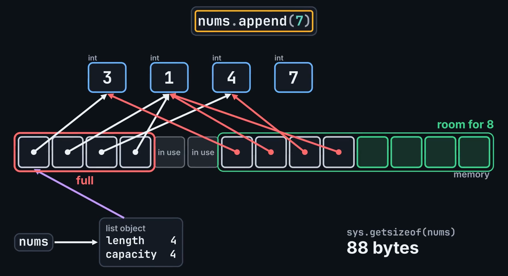

# What a Python list really holds: inside CPython's list object

What does Python actually do when you write `nums.append(7)`? These materials open a list up while it runs: the
list object's own fields, its block of slots read from memory, and what happens to them on every append. A slot
holds an arrow (the address `id()` gives you), not the item; the block keeps spare slots past the length; a full
block is swapped for a bigger one while the list object stays put; and the size of that bigger block follows one
line of CPython's source, checked here against 1,000 real appends.

```text
nums = []          len 0  capacity 0  56 bytes   block NULL
nums.append(3)     len 1  capacity 4  88 bytes   block 0x10335f190   a block of 4 slots at once
nums.append(1)     len 2  capacity 4  88 bytes   block 0x10335f190   one arrow written, nothing moved
nums.append(4)     len 3  capacity 4  88 bytes   block 0x10335f190   one arrow written, nothing moved
nums.append(1)     len 4  capacity 4  88 bytes   block 0x10335f190   now full
nums.append(7)     len 5  capacity 8 120 bytes   block 0x10347e7f0   a bigger block elsewhere, 4 arrows copied
id(nums) at every step: 0x1033e9480
```

From there the everyday surprises become things you can see in memory: why `[[0] * 3] * 3` changes three rows
at once (three slots, one address), why `sys.getsizeof` says 88 bytes for four small ints and for
four strings of 1,000 letters, why 972 of 1,000 appends just wrote one
arrow, and why `insert(0, x)` shifts every arrow in the list while a `deque` shifts none.



## What's inside

| | |
|---|---|
| [`notes.pdf`](notes.pdf) | The handout: what a slot holds, `[[0] * 3] * 3`, length vs capacity, append into a spare slot, a full block moving, the growth rule, the front of a list and `deque`, limits, common mistakes, exercises with answers |
| [`notebook.ipynb`](notebook.ipynb) | Look inside a list on your own machine, step by step, in seconds; `FULL = True` carries the growth run on to a million appends |
| [`code/arrows.py`](code/arrows.py) | The slots of `nums = [3, 1, 4, 1]` read from memory next to `id()` of each item; the two 1s; 88 bytes either way |
| [`code/grid.py`](code/grid.py) | `[[0] * 3] * 3`: three slots holding one address, the reference count, the comprehension fix, shallow and deep copies |
| [`code/capacity.py`](code/capacity.py) | Length vs capacity with `sys.getsizeof` alone (no `ctypes`): every append, and other ways to build the same list |
| [`code/watch_append.py`](code/watch_append.py) | The video's appends, reading `ob_size`, `allocated`, `ob_item` and `id` after each one |
| [`code/growth_rule.py`](code/growth_rule.py) | Every resize of 1,000 appends (or a million) against CPython's formula; new address or grown in place; the tally |
| [`code/front.py`](code/front.py) | `insert(0, 2)`: the slots before and after, every arrow one slot right; a `deque` adding a slot on the left instead |
| [`code/listpeek.py`](code/listpeek.py) | The small `ctypes` reader the scripts share, with a layout check that stops on interpreters it doesn't fit |
| [`figures/`](figures) | The pictures in the notes, stills from the video lesson |

## Run it

Python 3.9 or newer, standard library only; every script runs in well under a second.

```bash
python3 code/watch_append.py                     # the five appends, from the list's own fields
python3 code/watch_append.py --items 3 1 4 1 7 9 2 6 5 3
python3 code/growth_rule.py --n 1000000          # a million appends: under a second, about 50 MB
python3 code/capacity.py                         # no ctypes: works on any CPython
```

The scripts that read raw memory (`ctypes` at `id()` of the list) need CPython. They test the layout on a
throwaway list first and stop with a message on PyPy or a free-threaded build instead of reading nonsense.

## How the numbers were made

Nothing is timed. A short bench appends to real lists on CPython 3.12.7 (arm64) and reads the
list's own fields (`ob_size`, `ob_item`, `allocated`, at the offsets of `Include/cpython/listobject.h`) after
every step, checks the capacity against `sys.getsizeof` and every resize against the formula in
`Objects/listobject.c`. Addresses differ on every run and every machine; lengths, capacities, sizes and the
equalities (`slot == id(item)`, `id(nums)` unchanged) don't, on the same CPython version. The scripts here repeat
the bench's steps exactly.

Found a mistake, or a number you can't reproduce? Open an issue with the output of
`python3 code/growth_rule.py` and your Python version.

## About

Part of a series of short programming lessons that show what happens under the hood: a video, these notes, a
notebook and the code that reads every number from a real run.

Made by Bakytzhan Kurmanbek.

More lessons: [bkurmanbek on GitHub](https://github.com/bkurmanbek).

Ideas for a lesson, a collaboration or a project? bakytzhan.kurmanbek@nu.edu.kz
