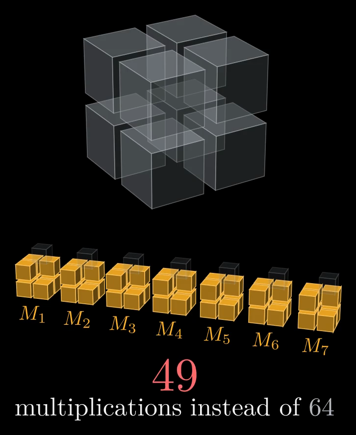

# What does it cost to multiply two tables of numbers?

Strassen's seven products, the exponent ω, and OpenAI's nine-fourths claim, counted multiplication by
multiplication. These materials start from a café bill you can do by hand and end at the paper of November 24,
2026, with code that counts every multiplication itself: numbers that tally their own `*`, so no count here is
typed and nothing is timed.

```text
orders × prices, the school way      8 multiplications   [[14, 8], [17, 9]]
Strassen's seven products            7 multiplications   [[14, 8], [17, 9]]
n × n tables, the school way         n³            1,073,741,824 at n = 1,024
Strassen on blocks inside blocks     n^2.807       282,475,249 at n = 1,024
the claimed floor (Nov 24, 2026)     ⌈n^(9/4)/2⌉   500,000,000 at n = 10,000
```

From there: why one saved multiplication compounds when the entries are blocks, what the exponent ω measures and
why it can't go below 2, the 16 records from 2.8074 in
1969 to 2.371177 in August 2026, the polynomial trick that
multiplies 3 + 2x by 5 + 4x with 3 products instead of 4, how
packing matrix products into polynomial products reaches 9/4, the claimed lower bound and its proof by
contradiction, and exactly what is and isn't checked as of 2026-11-25.



## What's inside

| | |
|---|---|
| [`notes.pdf`](notes.pdf) | The handout: the café bill by hand, the cube of n³ products, Strassen's seven products and why they work, blocks inside blocks, the exponent ω and its record line, upper and lower bounds, the polynomial trick, packing down to 9/4, the claimed floor, n^(9/4) = n² · n^(1/4), what is checked, common mistakes, exercises with answers, sources |
| [`notebook.ipynb`](notebook.ipynb) | Count every multiplication yourself: the café both ways, Strassen's identity checked with polynomials in eight letters, counts for 2^k rows, the three-point trick, the floor, the record staircase plotted; `FULL = True` for the notes' sizes |
| [`code/matmul.py`](code/matmul.py) | The clips' school-way program, exactly: three loops, 8 multiplications |
| [`code/strassen.py`](code/strassen.py) | The clips' Strassen program, exactly: seven products, then only additions |
| [`code/tally.py`](code/tally.py) | `Tracked` numbers that count their own multiplications, and both recipes; run it to see every product of the café bill as it happens |
| [`code/blocks.py`](code/blocks.py) | The school way and Strassen on blocks, run and counted up to 128 rows, formulas to 1,024; `--levels 16` shows the block products at every size |
| [`code/poly.py`](code/poly.py) | The polynomial trick: values at a few points, one product per point, an exact rebuild; up to 100 coefficients |
| [`code/exponent.py`](code/exponent.py) | From a block recipe to a power, log_v(r), and Rafael Pass's packing thresholds closing in on 9/4 |
| [`code/floor.py`](code/floor.py) | The claimed floor ⌈n^(9/4)/2⌉ in exact whole numbers, next to n² and n³ |
| [`code/records.py`](code/records.py) | The record staircase from 1969 to 2026 as text (`--plot` draws it with matplotlib) |
| [`figures/`](figures) | The pictures in the notes: stills from the video lessons and two charts drawn from the counts |

## Run it

Python 3.9 or newer, standard library only (matplotlib optional, for one plot). Every script runs from the folder
root or from `code/`.

```bash
python3 code/matmul.py                 # the clips' program: [[14, 8], [17, 9]], 8 multiplications
python3 code/tally.py                  # every multiplication of the cafe bill, both ways, as it happens
python3 code/blocks.py --quick         # school vs Strassen counted up to 32 rows: well under a second
python3 code/blocks.py                 # up to 128 rows, as in the notes: about 6 s, ~20 MB
python3 code/blocks.py --levels 16     # 1, 7, 49, 343 block products, then 2,401 multiplications of numbers
python3 code/poly.py                   # (3 + 2x)(5 + 4x) with 3 products; up to 100 coefficients: about 6 s
python3 code/floor.py                  # the claimed floor, exactly, from n = 2 to n = 100,000,000
python3 code/records.py --plot         # the record staircase, and records.png
```

## How the numbers were made

Nothing is timed. Every count is made by running a method on real numbers and counting the multiplications, with
the rule the papers use: a multiplication of two values that both depend on the input tables costs one; adding,
subtracting and multiplying or dividing by a fixed number cost nothing. The tables in `blocks.py` hold random whole
numbers from −9 to 9 (seed 20261125), and both recipes are checked to give the same answer at every size. The
café bill is made up: two customers, two drinks, two cities.

The news is cited, not computed: the paper, its README and its Lean statement as published in OpenAI's `math`
repository, the independent papers by Pass, Shpilka, and Doğan, Lysikov, Sakabe and Walter, and the history table
from Wikipedia, each linked in the notes. The lower bound is a claim as of 2026-11-25: an unreviewed
preprint written by an OpenAI model, whose Lean proof covers circuits that never divide. These materials explain
the claim; they don't check its proof.

Found a mistake, or a count you can't reproduce? Open an issue with the script's output and your Python version.

## About

Part of a series of short lessons that show what happens under the hood: a video, these notes, a notebook and the
code that makes every number from a real run.

Made by Bakytzhan Kurmanbek.

More lessons: [bkurmanbek on GitHub](https://github.com/bkurmanbek).

Ideas for a lesson, a collaboration or a project? bakytzhan.kurmanbek@nu.edu.kz
