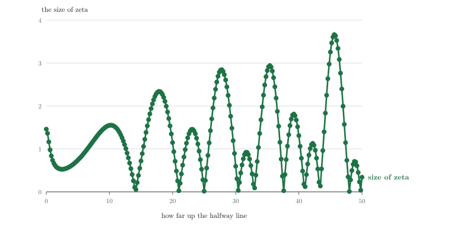

# Inside the Riemann hypothesis: primes, zeros, and a proof only computers have read

In 1859, Bernhard Riemann made a guess about the prime numbers. Ask a computer for
the first "zero" of Riemann's zeta function and you get one half, and 14.13. The second: one half
again. The guess is that every one of them, forever, has that same one half. This folder explains what that means
with pictures and school arithmetic, and lets you compute it: the primes counted as a staircase, the smooth curve
that follows them, a sum secretly built from the primes, the waves that rebuild the primes from zeta's zeros, a
check of the guess you can run yourself, and what exactly was and wasn't checked when a proof was announced on
November 20, 2026. No maths beyond school is needed for the notes; the maths sits in boxes marked *For the curious*.



What we computed (mpmath 1.3.0, sympy 1.14.0, Python 3.12.7):

| Piece | What it shows | Our run |
|---|---|---|
| the staircase | the count of primes against Gauss's smooth curve | up to a trillion: 37,607,912,018 primes; the curve is off by 38,263 |
| Euler's product | one factor per prime gives the same number as adding 1/n² | primes up to 99,991: 1.644932747 against π²/6 = 1.64493406685 |
| the zeros | zeta is zero at −2, −4, … and on the halfway line, at these heights | 14.13, 21.02, 25.01, 30.42, 32.94, … |
| the waves | a smooth curve plus one wave per zero rebuilds the staircase | largest gap between the steps: 0.916 with no zeros, 0.257 with 100 |
| the check | every zero up to a height, against the zeros on the halfway line | up to height 1,000: 649 = 649 |
| November 20, 2026 | a claimed proof in Lean, 17,374,215 lines | checked by computers and certified by the Lean community; no version a human can read, no peer review (as of November 21) |

## What's inside

| | |
|---|---|
| [`notes.pdf`](notes.pdf) | The handout, for anyone curious: the staircase of primes and the table up to a trillion, Euler's sum, the map and its halfway line, the waves (each zero adds one), 167 years of history, the two-way count you can run yourself and its limits, what the November 2026 check did and didn't establish (every fact with its source), common mistakes, five exercises with answers. The formulas and code sit in boxes you can skip |
| [`notebook.ipynb`](notebook.ipynb) | Compute it on your own machine; each section opens with a plain paragraph on what its cells show. The prime count against both curves with a pure-Python prime counter, Euler's product and why it works, the first zeros and the line in mpmath's code that fills in the one half, the two-way count up to a height you choose, and the staircase rebuilt from 0, 10 and 30 zeros, with figures. The default run takes a few minutes at most |
| [`code/check_rh.py`](code/check_rh.py) | The check on its own: `python3 code/check_rh.py 100` counts the zeros up to height 100 both ways and says whether they agree |
| [`figures/`](figures) | The charts in the notes, drawn from the computed numbers |

## Run it

Python 3 (we ran 3.12.7) with [mpmath](https://mpmath.org) for everything; matplotlib only for the notebook's figures
(every figure is also printed as numbers):

```bash
pip install mpmath matplotlib           # matplotlib is optional
python3 code/check_rh.py 100            # both counts below height 100: seconds
python3 code/check_rh.py 1000           # the notes' run (649 = 649): minutes
python3 code/check_rh.py 100 --step 2   # a grid too coarse for the zeros: watch the counts disagree
python3 code/check_rh.py 300 --zetazero # also count mpmath's own list of zeros (it only looks on the line)
```

Open `notebook.ipynb` in Jupyter or Colab and run all cells; set `FULL = True` in the first cell for the notes'
scale (π(x) up to 10¹², the count up to height 1,000, 100 zeros in the formula).

## How the numbers were computed

Nothing here is timed. The prime counts come from `sympy.primepi` (the notebook recounts them with Lucy Hedgehog's
method) and agree with OEIS A006880; li, R, ζ, θ and Z come from mpmath at 15 to 20 significant digits. The check
is floating point, not interval arithmetic: it shows the method that record verifications make rigorous, and it
says so whenever its own consistency checks fail (a count that isn't a whole number, a grid too coarse). The news
facts in section 8 of the notes are quoted from the sources linked there, with the status as of November 21, 2026.

Made with AI tools, including Claude. Claude is made by Anthropic, and Levent Alpöge, whose claimed proof the
notes describe, works at Anthropic. Found a mistake, or output that doesn't match? Open an issue with your mpmath
version and the output.

## About

Part of a series of lessons that open up one line of code and show the machinery underneath: a video, these
notes, a notebook and the code that computes every number.

Made by Bakytzhan Kurmanbek.

More lessons: [bkurmanbek on GitHub](https://github.com/bkurmanbek).

Ideas for a lesson, a collaboration or a project? bakytzhan.kurmanbek@nu.edu.kz
